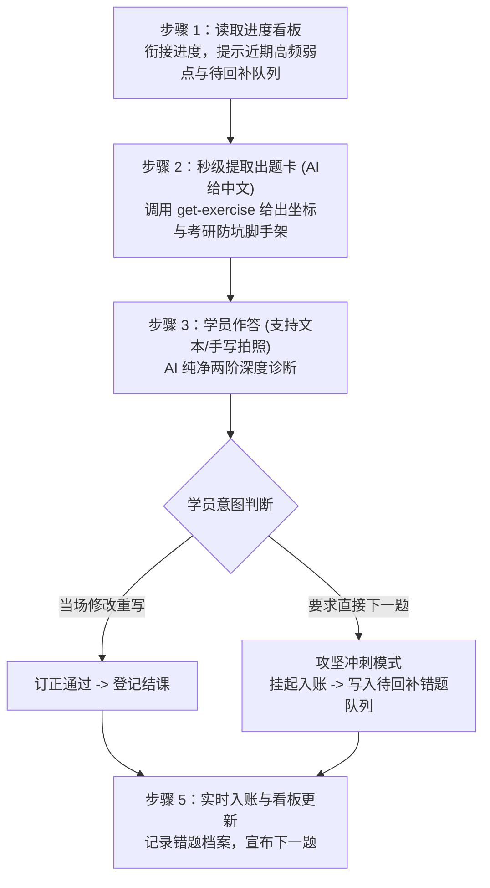

# 考研英语二“外脑资产内化与语法巩固”训练系统 (Kaoyan Asset Consolidator)

> **定位**：面向考研英语二（Task 1 小作文应用文 / Task 2 大作文图表文）的“框架系统搭建 + 语法硬伤根治”定向内化训练 Skill。  
> **设计原则**：严格遵循《需求说明书》与《OpenMinis Skill 开发与架构对齐指南》，100% 依托本地外脑知识库资产进行定向回译，直击外脑高级版原文，杜绝冗余保底版，全流程采用严谨学术排版（零 Emoji）。

---

## 目录

- [一、 项目背景与解决痛点](#一-项目背景与解决痛点)
- [二、 核心训练机制：五步闭环](#二-核心训练机制五步闭环)
- [三、 八大训练主题框架与 48 题标准化题库](#三-八大训练主题框架与-48-题标准化题库)
- [四、 资产库与持久化机制](#四-资产库与持久化机制)
- [五、 工程目录结构](#五-工程目录结构)
- [六、 随附 CLI 工具与自动化测试](#六-随附-cli-工具与自动化测试)
- [七、 Minis Android 沙箱环境执行规范](#七-minis-android-沙箱环境执行规范)
- [八、 部署与运行指引](#八-部署与运行指引)

---

## 一、 项目背景与解决痛点

前期已通过考研写作项目积累了 **19 篇历年真题终版高分范文**（小作文 11 篇、大作文 8 篇）以及近 **190 条结构化语料**（61 条核心功能句式与 128 条场景动宾语素）。目前处于“暂停写新题、集中盘活存量资产”的内化巩固阶段。

本 Skill 旨在根治以下核心痛点：
1. **独立造句语法错误频发**：主谓不一致、时态错位、名词单数裸奔、逗号粘连双句、数据单位错位等硬伤屡禁不止；
2. **知识碎片化，缺乏段落功能槽位意识**：脑海中的句式与语素缺乏按段落功能（首段定格/破题、次段展开/归因、尾段升华/闭环）组织的系统认知；
3. **低效出题与即兴脚本延迟**：旧版出题需多次翻阅长文本，手写图片旋转需现场写脚本试错，严重卡顿；新版已全面通过预制题库与内置 CLI 解决；
4. **做题心流冲突与跨会话复盘缺失**：学员冲刺做题手感时若被强制说教订正会严重受挫；新版内建“攻坚冲刺模式与待回补错题队列”，收工前统一回补复盘。

---

## 二、 核心训练机制：五步闭环

每次启动训练会话，AI 私教均严格执行以下闭环交互范式：



### AI 纯净两阶深度诊断
* **阶梯一：【学员初稿硬伤逐点纠错】**：指出学员原句的硬伤片段，说明语法规则并打标（如 `#可数单数裸奔`、`#主谓不一致`、`#逗号粘连双句`、`#数据单位错位`），保留学员合理表达主体。
* **阶梯二：【外脑高级版原文与考研升华手段剖析】**：直接展示外脑高分范文原句，重点剖析作者运用的高分句式与语法手段（后置定语、分词状语、名词化、独立主格、倒装强调等），直击考研 80+ 高分要求。

---

## 三、 八大训练主题框架与 48 题标准化题库

全周期课程由两大主线、共 8 个主题构成，并在 `references/curated_exercises.json` 中预制了 48 道覆盖大纲全节点的标准化训练题：

### 主线 A：大作文（Task 2）图表写作
* **主题 A1：第一段·图表数据定格描述**（柱状图动态增减/对比、饼图占比极值，涵盖 2010–2017 真题首段）；
* **主题 A2：第二段·因果机制推演与五大场景语素组装**（因果总起与展开，分批嵌入个人发展、消费经济、文化传承、科技互联网、公共治理 5 大维度语素）；
* **主题 A3：第三段·宏观总结、趋势预测与建议闭环**（趋势预测、政企协同引导、可持续发展倒装句）；
* **主题 A4：大作文真题全篇串联复盘**（2010–2017 年 8 篇大作文逐篇逐句回译通关）。

### 主线 B：小作文（Task 1）应用文写作
* **主题 B1：各文类首段·寒暄背景与写信目的**（建议、投诉、通知、邀请、道歉、回复信首段破题）；
* **主题 B2：各文类正文·核心要点展开与逻辑连词**（原因说明、活动细节展开、解决方案与要求）；
* **主题 B3：各文类尾段·礼貌呼应与期盼回信**（期待回复、再次致歉、感谢支持等收尾闭环）；
* **主题 B4：小作文真题全篇串联复盘**（2010–2020 年 11 篇小作文逐篇回译通关）。

---

## 四、 资产库与持久化机制

* **大纲与资产真题对齐**：大纲中 34 个核心训练节点 100% 对应 `assets/writing_brain/` 目录下的真题句式编号；
* **双持久化底座**：
  * `review_records/progress_dashboard.md`：全局训练进度、大纲勾选清单、分类错误频次统计与【待回补错题队列】；
  * `review_records/grammar_error_notebook.md`：历次做题作答、逐点诊断打标与高级版范文的流水档案；
* **墨墨背单词开放平台联动**：若学员在作答中出现词汇拼写错误，系统通过 `$MAIMEMO_SPELLING_TOKEN` 生成专属助记并注入当日复习流。

---

## 五、 工程目录结构

```
kaoyan-asset-consolidator/
├── SKILL.md                      # OpenMinis / AI 私教核心交互规程 (零 Emoji、直击高级版)
├── assets/                       # 考研英语二本地知识库外脑底座 (只读资产)
│   └── writing_brain/
│       ├── task1/
│       │   ├── expressions.jsonl # 35 条小作文功能句式库
│       │   ├── tasks.jsonl
│       │   └── archive/          # 2010–2020 年 11 篇小作文终版范文 Markdown
│       └── task2/
│           ├── expressions.jsonl # 26 条大作文功能句式库
│           ├── tasks.jsonl
│           └── archive/          # 2010–2017 年 8 篇大作文终版范文 Markdown
├── references/                   # 教学业务规程与参考规范
│   ├── curated_exercises.json    # 48 道真题级标准化练习题库 (含题干、脚手架、范文)
│   ├── curriculum_map.md         # 8 大主题大纲与真实语料 ID 映射表
│   ├── grammar_rubric.md         # 七大硬伤分类与两阶诊断标准
│   ├── dashboard_templates.md    # 看板、错题本与待回补队列模板定义
│   └── maimemo_api.md            # 墨墨背单词错词复习推送规范与接口契约
├── scripts/                      # 随附轻量 Python 工具集 (无外部重依赖，适配沙箱)
│   ├── consolidator.py           # 核心引擎：状态读取、秒级提取、图片扶正、回补队列维护
│   ├── maimemo_sync.py           # 墨墨错词推送引擎：解析生词、深度助记、注入今日复习
│   ├── test_consolidator.py      # 核心引擎单元测试套件 (13 项测试)
│   └── test_maimemo_sync.py      # 墨墨推送单元测试套件 (11 项测试)
└── review_records/               # 本地持久化记录目录 (开箱即用)
    ├── progress_dashboard.md     # 训练进度、弱点分布与待回补错题队列看板
    └── grammar_error_notebook.md # 练习档案与语法错题记录本
```

---

## 六、 随附 CLI 工具与自动化测试

随附工具基于 Python 3 标准库（图片预处理支持 PIL/Pillow），严格适配 Minis Android 沙箱环境：

```bash
# 1. 运行全部自动化单元测试套件 (24 项全通)
python -m unittest discover -s scripts -p "test_*.py"

# 2. 秒级提取指定节点真题练习题 (输出纯净出题卡与脚手架)
python scripts/consolidator.py get-exercise --id T2_CHART_SEN_014

# 3. 手机手写拍照图片预处理 (自动根据 EXIF 旋转方向扶正图片)
python scripts/consolidator.py prepare-image --input /path/to/upload.jpg

# 4. 系统环境与凭据体检 (诊断短命进程、文件落盘、存储挂载与墨墨凭据)
python scripts/consolidator.py doctor

# 5. 查看当前看板状态与待回补错题队列
python scripts/consolidator.py status

# 6. 持久化一道题 (支持通过落盘 settle.json 传参，支持 --status pending_revision)
python scripts/consolidator.py record --file ./settle.json
```

---

## 七、 Minis Android 沙箱环境执行规范

本 Skill 专为 Minis Android 沙箱环境设计，严格落地三大执行规范：

1. **短命进程模型 (Short-lived process model)**：
   - 宿主执行的每条命令均为独立子进程（`/bin/sh -c "<cmd>"`），进程间不持久化上下文；
   - 统一采用绝对路径调用解释器与脚本；脚本退出码明确（0 成功，非 0 报错），无后台常驻 Daemon。
2. **文件落盘数据流 (File persistence data flow)**：
   - 长文本与批处理 JSON 严禁通过命令行参数拼接；统一采用“先落盘后传参”：优先写入沙盒工作区（如 `./settle.json`），再通过 `--file` 传参。
3. **外脑持久化解耦 (External persistence decoupling)**：
   - 复盘看板与错题记录本优先挂载于外部存储目录：`/var/minis/mounts/Documents/考研英语/资产复盘/`；
   - 沙箱容器重建或重置后，学员学习进度与错题档案永久留存。

---

## 八、 部署与运行指引

### 在 OpenMinis (Android / iOS) 中运行
1. 将本仓库同步到 OpenMinis 的 `/var/minis/skills/kaoyan-asset-consolidator` 目录；
2. 外脑数据可通过外部存储挂载至 `/var/minis/mounts/Documents/考研英语/写作外脑/`，持久化复盘记录可自动同步至 `/var/minis/mounts/Documents/考研英语/资产复盘/`；
3. 在对话框中输入 `/kaoyan-asset-consolidator` 即可启动训练。

### 在 PC / Antigravity CLI 中运行
1. 工作区直接定位至本项目目录 `D:\Fuchen\project\kaoyan-asset-consolidator`；
2. 脚本将自动识别内置的 `assets/writing_brain` 与 `review_records/`；
3. 直接与 AI 助手对话，提示：“开始今日考研英语资产内化训练”，AI 即会严格按照 `SKILL.md` 的规范执行 5 步训练闭环。
