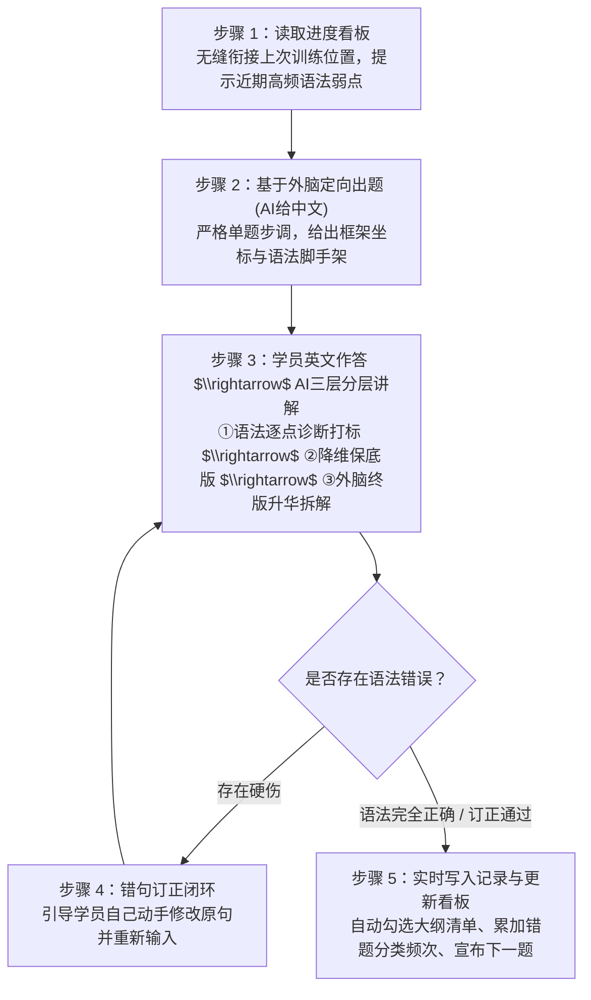

# 考研英语二“外脑资产内化与语法巩固”训练系统 (Kaoyan Asset Consolidator)

> **定位**：面向考研英语二（Task 1 小作文应用文 / Task 2 大作文图表文）的“框架系统搭建 + 语法硬伤根治”定向内化训练 Skill。  
> **设计依据**：严格遵循《需求说明书》与《OpenMinis Skill 开发与架构对齐指南》，100% 依托本地外脑知识库资产进行定向回译与分层诊断。

---

## 目录

- [一、 项目背景与解决痛点](#一-项目背景与解决痛点)
- [二、 核心训练机制：五步闭环](#二-核心训练机制五步闭环)
- [三、 八大训练主题框架（段落功能槽位）](#三-八大训练主题框架段落功能槽位)
- [四、 资产库与持久化机制](#四-资产库与持久化机制)
- [五、 工程目录结构](#五-工程目录结构)
- [六、 随附 CLI 工具与自动化测试](#六-随附-cli-工具与自动化测试)
- [七、 部署与运行指引](#七-部署与运行指引)

---

## 一、 项目背景与解决痛点

前期已通过考研写作项目积累了 **19 篇历年真题终版高分范文**（小作文 11 篇、大作文 8 篇）以及近 **190 条结构化语料**（61 条核心功能句式与 128 条场景动宾语素）。目前处于“暂停写新题、集中盘活存量资产”的内化巩固阶段。

本 Skill 旨在根治以下核心痛点：
1. **独立造句语法错误频发**：主谓不一致、时态错位、名词单数裸奔、逗号粘连双句等硬伤屡禁不止；
2. **知识碎片化，缺乏段落功能槽位意识**：脑海中的句式与语素缺乏按段落功能（首段定格/破题、次段展开/归因、尾段升华/闭环）组织的系统认知；
3. **能力阶梯断层**：本地归档的终版范文从句密集、难度偏高，学员独立输出时存在明显的落差感与挫败感；
4. **跨会话记忆与复盘缺失**：缺乏跨会话的实时进度追踪与错题统计沉淀。

---

## 二、 核心训练机制：五步闭环

每次启动训练会话，AI 私教均严格执行以下闭环交互范式：



### AI 深度分层讲解的三层阶梯
* **阶梯一：【语法逐点诊断与讲解】**：指出学员原句的硬伤片段，用通俗母语讲解“为什么错”与“正确规则”，标注标准错误标签（如 `#可数单数裸奔`、`#主谓不一致`、`#逗号粘连双句`）。
* **阶梯二：【降维保底版（能力阶梯讲解）】**：保留学员思路，嵌入外脑目标语素，构建一个简单清晰、主谓宾安全、无复杂多层从句嵌套的“基础高分句”，树立考场保底标尺。
* **阶梯三：【外脑终版对齐与升华拆解】**：展示本地真题范文中的原版高分句，剖析作者运用了何种高级语法手段（非限制性从句、分词作状语、名词化、倒装强调等）实现句式进阶。

---

## 三、 八大训练主题框架（段落功能槽位）

全周期课程由两大主线、共 8 个主题构成（详见 [`references/curriculum_map.md`](file:///D:/Fuchen/project/kaoyan-asset-consolidator/references/curriculum_map.md)）：

### 主线 A：大作文（Task 2）图表写作
* **主题 A1：第一段·图表数据定格描述**（柱状图动态增减/对比、饼图占比极值，涵盖 2010–2017 真题首段）；
* **主题 A2：第二段·因果机制推演与五大场景语素组装**（因果总起与展开，分批嵌入个人发展、消费经济、文化传承、科技互联网、公共治理 5 大维度语素）；
* **主题 A3：第三段·宏观总结、趋势预测与建议闭环**（趋势预测、政企协同引导、可持续发展倒装句）；
* **主题 A4：大作文真题全篇串联复盘**（2010–2017 年 8 篇大作文逐篇逐句回译通关）。

### 主线 B：小作文（Task 1）应用文写作
* **主题 B1：各文类首段·寒暄背景与写信目的**（建议、投诉、通知、邀请、道歉、回复信首段破题）；
* **主题 B2：各文类正文·核心要点展开与逻辑衔接**（提建议/做推荐、活动安排/招募要求、解释原因/表达诉求三大功能群组）；
* **主题 B3：各文类尾段·期盼回复与礼貌闭环**（各类书信与告示的规范结尾功能句）；
* **主题 B4：小作文真题分类串联复盘**（2011–2021 年共 11 篇范文按文类归纳，逐篇逐句回译通关）。

---

## 四、 资产库与持久化机制

### 1. 资产库溯源 (100% 依附本地外脑)
* **篇目归档库 (`assets/writing_brain/*/archive/`)**：
  - 小作文（Task 1）：2011–2021 年共 11 篇终版范文及元数据；
  - 大作文（Task 2）：2010–2017 年共 8 篇终版范文及元数据。
* **结构化语料库 (JSONL)**：
  - `shared/morphemes.jsonl`：128 条场景动宾语素；
  - `task1/expressions.jsonl`：35 条小作文功能句式；
  - `task2/expressions.jsonl`：26 条大作文功能句式。

### 2. 持久化文档 (复盘看板与错题本)
* **《训练进度与状态看板文档》(`review_records/progress_dashboard.md`)**：
  - 48 项全局课程大纲复选框清单 (`[x]` / `[ ]`)；
  - 记录 `Current State`（当前所处位置）与 `Next Step`（下一步行动指令）；
  - 维护近期 3～5 个阶段性语法薄弱点备忘。
* **《练习档案与语法错题记录本》(`review_records/grammar_error_notebook.md`)**：
  - 上部：六大语法错误分类的累计频次与典型错例看板；
  - 下部：逐题练习流水账卡片（题目时间、中文、学员原始作答、诊断摘要、降维保底版、外脑终版）。

---

## 五、 工程目录结构

```
kaoyan-asset-consolidator/
├── 需求文档.md                   # 原始需求说明书
├── README.md                     # 本说明文档
├── SKILL.md                      # OpenMinis / Antigravity 标准 Skill 定义文件
├── assets/                       # 本地外脑知识资产（完整内嵌）
│   └── writing_brain/
│       ├── shared/
│       │   └── morphemes.jsonl   # 128 条场景动宾语素库
│       ├── task1/
│       │   ├── expressions.jsonl # 35 条小作文功能句式库
│       │   ├── tasks.jsonl
│       │   └── archive/          # 2011–2021 年 11 篇小作文终版范文 Markdown
│       └── task2/
│           ├── expressions.jsonl # 26 条大作文功能句式库
│           ├── tasks.jsonl
│           └── archive/          # 2010–2017 年 8 篇大作文终版范文 Markdown
├── references/                   # 教学业务规程与参考规范
│   ├── curriculum_map.md         # 8 大主题与语料详细映射表
│   ├── grammar_rubric.md         # 语法六大硬伤分类与三阶诊断标准
│   ├── dashboard_templates.md    # 看板与错题本标准模板定义
│   └── maimemo_api.md            # 墨墨背单词错词复习推送规范与接口契约
├── scripts/                      # 随附无依赖轻量 Python 3 工具集
│   ├── consolidator.py           # 核心引擎：状态读取、大纲勾选、错题归档与诊断
│   ├── maimemo_sync.py           # 墨墨错词推送引擎：解析生词、深度助记、注入今日复习
│   ├── test_consolidator.py      # 核心引擎单元测试套件
│   └── test_maimemo_sync.py      # 墨墨推送单元测试套件
└── review_records/               # 本地持久化记录目录 (开箱即用)
    ├── progress_dashboard.md     # 训练进度与状态看板
    └── grammar_error_notebook.md # 练习档案与语法错题记录本
```

---

## 六、 随附 CLI 工具与自动化测试

随附工具仅使用 Python 3 标准库，无外部包依赖，严格适配 Minis Android 沙箱环境规范：

```bash
# 1. 运行全部自动化单元测试套件 (20项全通)
python -m unittest discover scripts

# 2. 系统、沙箱规范合规性与凭据体检 (诊断短命进程模型、文件落盘数据流、外部挂载持久化解耦与墨墨凭据)
python scripts/consolidator.py doctor

# 3. 查看当前训练看板状态与下一步指令
python scripts/consolidator.py status

# 4. 列出主题条目与提取出题素材
python scripts/consolidator.py list-theme --theme A1
python scripts/consolidator.py get-item --theme A1 --index 1

# 5. 【Minis 沙箱标准数据流】基于落盘 JSON 持久化一道题 (支持绝对路径与相对工作区路径)
# 先将结构化诊断写入 /var/minis/workspace/kaoyan/settle.json，再执行：
python scripts/consolidator.py record --file /var/minis/workspace/kaoyan/settle.json

# 6. 独立测试墨墨错词推送引擎 (同样支持 --file 传参)
python scripts/maimemo_sync.py --example
python scripts/consolidator.py maimemo-sync --mock --data '{"words":[{"spelling":"accommodate","type":"spelling_fix","misspelling":"acommodate"}]}'
```

---

## 七、 Minis Android 沙箱环境执行规范

本 Skill 专为 Minis Android 沙箱环境设计，严格落地三大执行规范：

1. **短命进程模型 (Short-lived process model)**：
   - 宿主执行的每条命令均为独立子进程（`/bin/sh -c "<cmd>"`），进程间不持久化上下文（`cd`、环境变量等）；
   - 统一采用绝对路径调用解释器与脚本（如 `/usr/bin/python3 /var/minis/.../consolidator.py`）；
   - 脚本均为即开即走的单次执行设计，退出码明确（0 成功，非 0 报错），无后台常驻 Daemon。
2. **文件落盘数据流 (File persistence data flow)**：
   - 长文本（中文原句、英文初稿、多行诊断、保底高分句）与批处理 JSON 严禁通过命令行参数拼接；
   - 统一采用“先落盘后传参”：优先写入沙盒工作区（如 `/var/minis/workspace/kaoyan/settle.json` 或 `./settle.json`），再通过 `--file` 传参；
   - 脚本支持绝对路径与相对工作区路径自动探测解析。
3. **外脑持久化解耦 (External persistence decoupling)**：
   - 复盘看板与错题记录本优先挂载于宿主外部存储目录：`/var/minis/mounts/Documents/考研英语/资产复盘/`；
   - 写作外脑知识库底座优先挂载于宿主外部存储目录：`/var/minis/mounts/Documents/考研英语/写作外脑/`；
   - 容器生命周期解耦：沙箱容器重建或重置后，学员学习进度与错题档案永久留存。

---

## 七、 部署与运行指引

### 在 OpenMinis (Android / iOS) 中运行
1. 将本仓库同步到 OpenMinis 的 `/var/minis/skills/kaoyan-asset-consolidator` 目录；
2. 外脑数据可通过外部存储挂载至 `/var/minis/mounts/Documents/考研英语/写作外脑/`，持久化复盘记录可自动同步至 `/var/minis/mounts/Documents/考研英语/资产复盘/`；
3. 在对话框中输入 `/kaoyan-asset-consolidator` 即可启动训练。

### 在 PC / Antigravity CLI 中运行
1. 工作区直接定位至本项目目录 `D:\Fuchen\project\kaoyan-asset-consolidator`；
2. 脚本将自动识别内置的 `assets/writing_brain` 与 `review_records/`；
3. 直接与 AI 助手对话，提示：“开始今日考研英语资产内化训练”，AI 即会严格按照 `SKILL.md` 的规范执行 5 步训练闭环。
