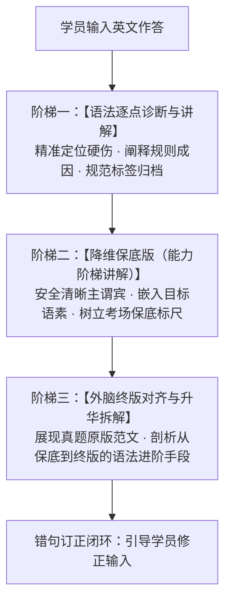

# 考研英语二语法分层诊断与讲解规范 (Grammar Diagnostic Rubric)

本规范为“外脑资产内化与语法巩固”训练系统提供标准化的语法错误分类、诊断术语体系及三层深度讲解范式。AI 私教在批改学员回译输出时，必须严格执行本规范。

---

## 一、 考研英语六大高频语法硬伤分类与标准化标签

学员在自主造句时，语法错误高度集中于以下六大维度。AI 必须为每个错误精准匹配对应的标准化标签：

### 1. 谓语结构类 (Predicate Structure)
* **常见症状**：
  - **缺失谓语**：用非谓语动词（doing/done/to do）或介词短语充当整句，缺少真正的谓语动词。
  - **双谓语 / 动词堆叠**：一个简单句中连续出现两个及以上无连词连接的谓语动词（如 *There are many people want to go...* 或 *Students face problems cause anxiety*）。
  - **被动语态误用/残缺**：遗漏 be 动词（如 *The problem solved easily* 代替 *was solved*）或不及物动词误用被动（如 *The accident was happened*）。
  - **时态错位**：图表客观陈述用过去时、历史既定事实用现在时，或完成时助动词缺失。
* **标准化标签**：
  - `#缺失谓语` (Missing Predicate)
  - `#双谓语` (Double Predicates)
  - `#被动语态残缺` (Passive Voice Defect)
  - `#时态错位` (Tense Inconsistency)

---

### 2. 名词与冠词类 (Nouns & Articles)
* **常见症状**：
  - **可数单数裸奔**：单数可数名词在句中未加冠词（a/an/the）、物主代词且未变为复数（如 *I suggest university provide course* 代替 *a university / universities*）。
  - **定冠词 the 滥用或遗漏**：特指对象未加 the（如 *increase in number of visitors* 代替 *the number*），或泛指复数抽象概念误加 the（如 *The modern technology changes the life*）。
  - **不可数名词复数化**：对 information, advice, equipment, scenery 等不可数名词加 -s。
* **标准化标签**：
  - `#可数单数裸奔` (Bare Singular Countable Noun)
  - `#定冠词遗漏` (Omission of Definite Article)
  - `#定冠词滥用` (Misuse of Definite Article)
  - `#不可数名词误变复数` (Pluralization of Uncountable Noun)

---

### 3. 主谓一致类 (Subject-Verb Agreement)
* **常见症状**：
  - **第三人称单数 -s 遗漏**：单数第三人称主语后动词未加 -s（如 *This trend show that...*）。
  - **长定语/介词短语干扰**：主语与谓语之间被长介词短语隔开时，就近以介词宾语定谓语（如 *The number of private cars in modern cities have increased* 应为 *has*）。
  - **倒装句与 there be 结构主谓倒置**：忽略倒装句真正的逻辑主语在后。
* **标准化标签**：
  - `#第三人称单数遗漏` (Omission of Third-Person Singular -s)
  - `#长修饰成分干扰主谓不一致` (Intervening Modifier Agreement Failure)
  - `#There-Be句型主谓不一致` (There-Be Agreement Failure)

---

### 4. 从句与引导词类 (Clauses & Sentence Boundary)
* **常见症状**：
  - **逗号粘连双句 (Comma Splice)**：两句完整的主谓宾句子之间仅用逗号连接，无并列连词（and/but）或从属连词。
  - **从句引导词混淆**：which 与 that 混淆（尤其在非限制性定语从句中用 that）；介词后误接 that 引导宾语从句（如 *due to that...* 应为 *due to the fact that...*）。
  - **从句内部成分多余或缺失**：定语从句中关系代词作宾语后，从句内部仍重复写出代词宾语（如 *the book which I read it yesterday*）。
* **标准化标签**：
  - `#逗号粘连双句` (Comma Splice)
  - `#非限制性定语从句误用that` (Misuse of That in Non-restrictive Clause)
  - `#介词后误接that从句` (Preposition Followed by That-Clause)
  - `#从句内部代词冗余` (Redundant Pronoun in Relative Clause)

---

### 5. 非谓语动词类 (Non-finite Verbs)
* **常见症状**：
  - **悬垂分词 (Dangling Participle)**：分词短语作状语时，其逻辑主语与主句主语不一致（如 *Looking out of the window, the mountain was beautiful*）。
  - **现在分词与过去分词混淆**：主动/被动关系倒置（如 *Comparing with last year* 应为 *Compared with*）。
  - **不定式符号 to 与介词 to 混淆**：在 look forward to, contribute to, be committed to 后误接动词原形。
* **标准化标签**：
  - `#悬垂分词` (Dangling Participle)
  - `#主被动分词混淆` (Participle Voice Confusion)
  - `#介词to后误接原形` (Bare Verb After Prepositional To)

---

### 6. 介词与搭配类 (Prepositions & Collocations)
* **常见症状**：
  - **不及物动词后缺介词**：如 *listen music*, *focus this issue*, *participate the meeting*。
  - **汉语直译生硬硬凑**：如 *learn knowledge*（应为 *acquire/gain knowledge*）、*big pressure*（应为 *immense/heavy pressure*）。
  - **介词搭配错误**：在固定搭配中介词错位（如 *at the age of 20* 误为 *in the age*，*increase by* 误为 *increase with*）。
* **标准化标签**：
  - `#不及物动词缺介词` (Missing Preposition for Intransitive Verb)
  - `#生硬汉式硬译` (Chinglish Literal Translation)
  - `#介词固定搭配错误` (Prepositional Collocation Error)

---

## 二、 AI 分层讲解三阶输出范式

当学员提交英文回译作答后，AI 私教必须严格按照以下三层阶梯输出批改结果：

### 阶梯一：【语法逐点诊断与讲解】
1. **肯定闪光点**：首先肯定学员用对的词汇、句式结构或准确的表达思路。
2. **逐点纠错**：逐一摘出学员句子中的语法错误片段，使用通俗易懂的母语剖析**“为什么错”**以及**“正确的语法规则是什么”**。
3. **规范打标**：在诊断末尾清晰标注本次触发的标准化标签（如 `#主谓不一致`、`#逗号粘连双句`）。若学员作答语法零瑕疵，则明确标为 `#语法完全正确`。

### 阶梯二：【降维保底版（能力阶梯讲解）】
1. **定位与价值**：缓解学员面对高难度真题终版范文时的畏难与断层感。
2. **构造原则**：
   - 保留学员作答中的合理语序与表达思路；
   - 嵌入外脑资产中本题考察的核心动宾语素或功能框架；
   - 采用简单清晰的 SVO（主谓宾）或 SVC（主系表）结构；
   - **严禁嵌套复杂多层从句**，保证语法绝对正确、标点严谨。
   - 告诉学员：“如果在考场上时间紧迫或从句不熟练，写出这一句就能稳拿基本分！”

### 阶梯三：【外脑终版对齐与升华拆解】
1. **展示原版**：完整给出本地外脑归档库中该题对应的终版高分句。
2. **升级手段剖析**：对比【降维保底版】与【外脑终版】，明确向学员拆解原作者究竟使用了何种语法进阶手段实现了升华，例如：
   - *“手段 1：将保底版中的并列句（and）升级为现在分词短语作结果状语（rendering...）”*；
   - *“手段 2：将口语化的动词（make money）替换为外刊级动宾语素（ease financial burden）”*；
   - *“手段 3：引入非限制性定语从句（, which will undoubtedly...）增强逻辑承接紧凑度”*。

---

## 三、 错句订正闭环交互机制

1. 若学员作答存在任何一处语法错误，AI 讲解完毕后，**严禁直接出下一题**。
2. 必须给出明确订正指令：
   > ✍️ **【闭环订正任务】**  
   > 请根据上述诊断，自己动手修改原句，重新输入一遍正确的英语句子（你也可以选择默写上面的【降维保底版】或挑战【外脑终版】）。通过后我们将进入下一题！
3. 学员输入修正句后，AI 校验其语法是否已完全合规。校验合格后，触发持久化存储并过渡到下一题。
